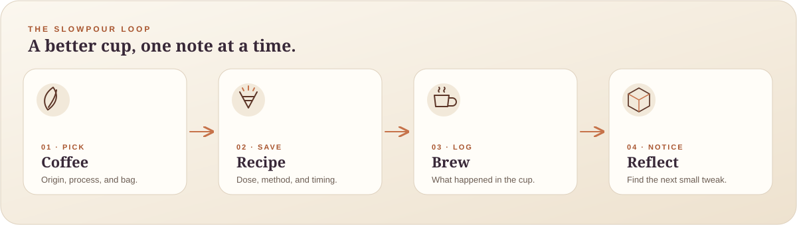

# SlowPour

### Every cup has a story.

SlowPour is a personal coffee journal for the beans you bring home, the recipes you repeat, and the little changes that make a brew click. Follow each coffee from the first bag to the last sip, then keep what you learn for next time.

## A journal for the whole brew

- **Coffee shelf:** keep coffees and open or finished bags together, with their origin and processing details.
- **Recipe notebook:** save repeatable brew methods and settings, then choose a go-to recipe for each coffee.
- **Brew journal:** use the timer, log what you brewed, and keep tasting notes alongside the recipe you followed.
- **Your setup:** track grinders, brewers, scales, and kettles so each brew has useful context.
- **Insights:** revisit your brew history to spot favorite coffees and methods.

The idea is simple: keep the useful details close, but make recording a cup feel more like journaling than filling out a spreadsheet.

## Your journal, kept between cups

Accounts and journal data are stored in Postgres. A new account starts with example coffees and brews to explore. If you used the earlier browser demo, Settings has an explicit import button; the browser copy remains untouched.

## Run your own

Install dependencies with `npm install`, set `DATABASE_URL`, `GOOGLE_CLIENT_ID`, `GOOGLE_CLIENT_SECRET`, and `APP_ORIGIN` (see `.env.example`), then run `npm run dev`. Create a Google OAuth **Web application** client and authorize `${APP_ORIGIN}/api/auth/google/callback` as a redirect URI. `APP_ORIGIN` must be the exact public site origin (HTTPS in production). Database changes live in `supabase/migrations/`. Apply the Google-only migration before deploying this code. To apply migrations manually, link the Supabase CLI to your project and run `npm run db:migrate`. Once Supabase's GitHub integration is enabled with working directory `.`, it applies new migrations from `main` automatically. On Vercel, set all four environment variables for production and preview, with an authorized redirect URI for each origin.

The Next.js route handlers provide Google sign-in, sessions, and account-scoped journal reads and writes. The Google-only migration drops stored password hashes and invalidates old sessions. Existing journals are attached to the same account when the first verified Google sign-in uses its Gmail or Google Workspace email address; later sign-ins use Google's stable account ID. Existing accounts using other email domains need a manual identity migration, since Google may no longer control those mailboxes. The current UI saves a journal snapshot as one document; the migration also defines domain tables for a future move to granular record endpoints.
